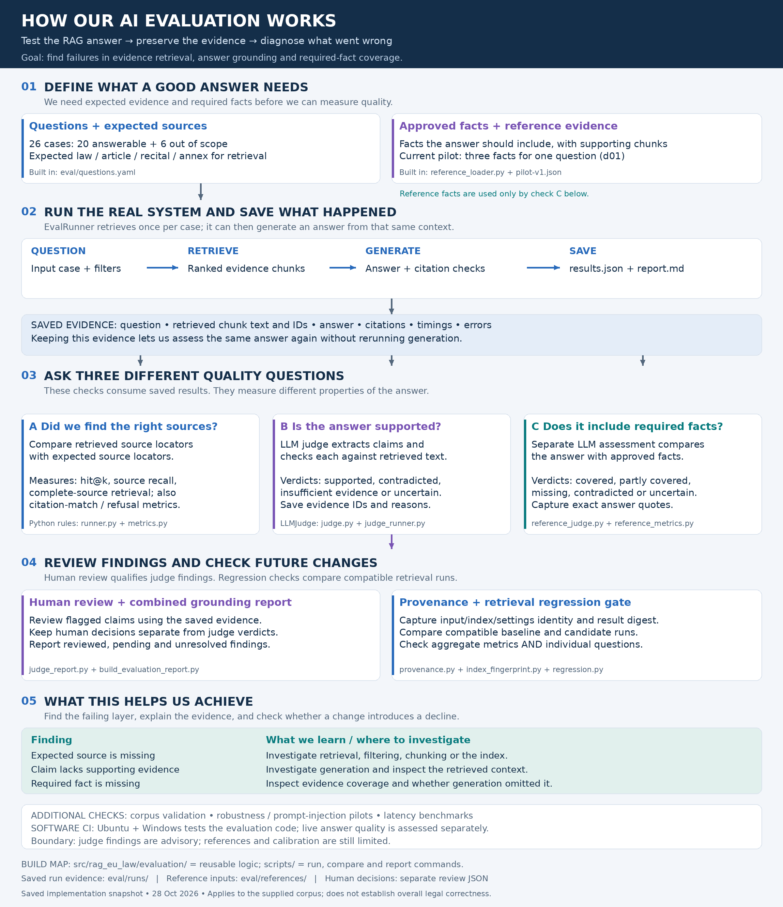
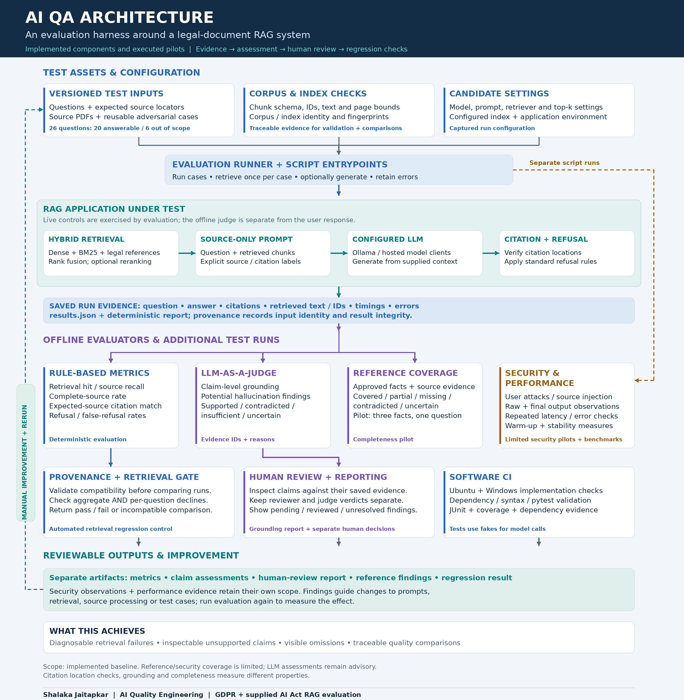
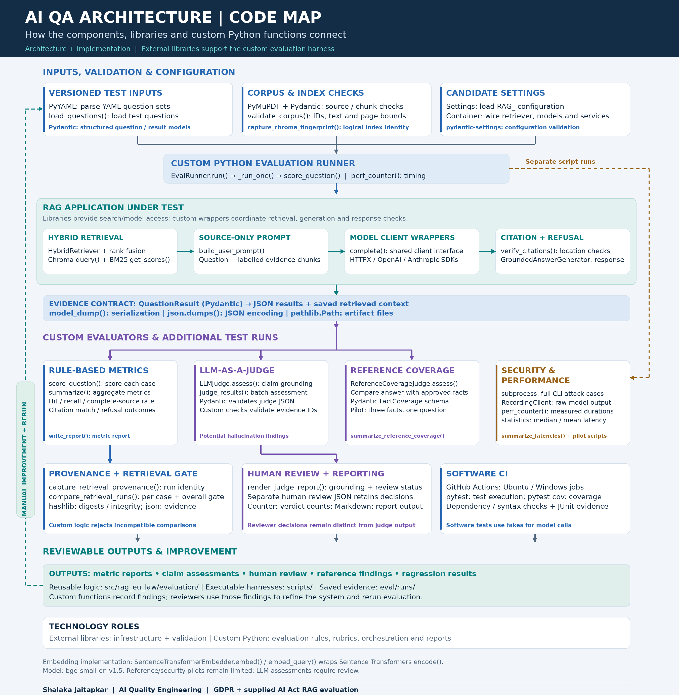

# EU Law RAG — AI Quality Assurance and Evaluation

A Python RAG application with an evaluation harness that checks **what evidence was retrieved, whether answer claims follow that evidence, and whether required facts were included**.

The application answers questions from supplied GDPR and AI Act PDFs. The surrounding QA framework preserves evidence, applies deterministic checks and LLM assessments, supports human review, and compares compatible retrieval runs.

**Purpose:** make AI failures diagnosable and changes reviewable. A high retrieval score, a valid citation and a supported claim measure different properties.

> **Corpus scope:** the supplied AI Act PDF is the European Parliament first-reading text of 13 March 2024, not the final Official Journal regulation. Findings apply to this corpus. Generated answers are not legal advice. See [source documents](data/raw/README.md).

## Read this README in three passes

1. **Understand the purpose:** start with Diagram 1 and the worked example.
2. **Understand the system:** use Diagram 2 to follow execution, evidence, evaluators and review.
3. **Understand the code:** use Diagram 3 and the implementation tables to locate libraries, classes and functions.

The diagrams describe the implemented baseline and limited pilots. They do not claim automatic deployment approval, production monitoring or universal hallucination prevention.

## Contents

- [What the project achieves](#what-the-project-achieves)
- [Diagram 1 — evaluation explained](#diagram-1--evaluation-explained)
- [Diagram 2 — implemented architecture](#diagram-2--implemented-architecture)
- [Diagram 3 — libraries and functions](#diagram-3--libraries-and-functions)
- [A worked example](#a-worked-example)
- [Technology and library map](#technology-and-library-map)
- [How the evaluation is implemented](#how-the-evaluation-is-implemented)
- [Guardrails, judges and quality gates](#guardrails-judges-and-quality-gates)
- [Project at a glance](#project-at-a-glance)
- [What happens at each application stage](#what-happens-at-each-application-stage)
- [Understanding the metrics](#understanding-the-metrics)
- [Implementation and file responsibilities](#implementation-and-file-responsibilities)
- [Application setup](#application-setup)
- [Running the evaluation](#running-the-evaluation)
- [Recorded results and their limits](#recorded-results-and-their-limits)
- [Project structure](#project-structure)
- [CI, remaining work and documentation](#ci-remaining-work-and-documentation)

## What the project achieves

| Question | Mechanism | Useful outcome |
|---|---|---|
| Is the extracted corpus structurally usable? | Chunk/schema/source-page validation and manual fidelity samples | Extraction issues become visible before answer evaluation |
| Did retrieval find the expected sources? | Expected-source matching, recall and missing-source records | Investigate filtering, chunking, indexing and ranking |
| Does the answer claim more than its evidence supports? | Claim-level LLM grounding assessment | Inspect potential hallucinations with evidence references and reasons |
| Did the answer omit a required fact? | Approved reference-fact coverage pilot | Separate incomplete answers from unsupported claims |
| Can we trust the judge finding? | Human review, preserved disagreements and calibration samples | Model verdicts remain inspectable and provisional |
| Did a candidate introduce retrieval declines? | Provenance compatibility plus aggregate/per-question regression | An improvement on one case cannot hide another case's decline |
| How does the system behave under adversarial cases or repeated execution? | Security/robustness pilots and benchmarks | Preserve observed failures, latency and stability evidence |
| Does the evaluation code behave as intended? | Unit/contract/integration tests and Ubuntu/Windows CI | Check software behaviour separately from live answer quality |

## Diagram 1 — evaluation explained



**Read from top to bottom.** Define the questions and expected evidence, run the actual application, and save what happened. Three evaluators then ask separate questions:

- **Retrieval:** did we find the expected sources?
- **Grounding:** does the retrieved text support each substantive claim?
- **Coverage:** did the answer include approved required facts?

Reference facts are evaluation inputs; they are not silently inserted into the answer-generation prompt. This separation helps reveal genuine omissions.

The grounding judge uses the saved answer and captured context. Rejudging that evidence does not require regenerating the answer, although the judge itself makes model requests. Human review inspects the evidence; regression compares compatible retrieval runs.

## Diagram 2 — implemented architecture



**Follow the arrows between components.** This is an evaluation harness around an existing application:

1. **Test assets and configuration** identify the question set, corpus/index and candidate settings.
2. **The evaluation runner** retrieves once per question and optionally generates using that same context.
3. **The RAG application under test** performs hybrid retrieval, builds a source-labelled prompt, calls the configured model and verifies citation locations.
4. **Saved run evidence** connects application execution to deterministic metrics, the grounding judge and the reference pilot.
5. **Human review** consumes claim-level findings. **The retrieval gate** consumes compatible baseline/candidate evidence. **Software CI** separately checks the code.
6. **Reviewable outputs** remain separate artifacts: metric reports, judge results, human reviews, reference findings, regression results and pilot observations.

The orange branch represents **separate security/performance script executions**, not evaluations inferred solely from saved answers. The dashed improvement loop is a manual engineering process: investigate a finding, change the relevant component, then rerun evaluation. It is not an autonomous self-modifying agent.

## Diagram 3 — libraries and functions



**Use this diagram to connect an architectural responsibility to its implementation.** External libraries supply PDF access, embeddings, search, model clients, schemas and testing. Custom Python supplies the orchestration, legal-reference handling, metric definitions, grounding rubric, report logic and regression policy.

For example, `LLMJudge.assess()` is our method. It uses the configured client's `complete()` method and Pydantic validation. Pydantic validates the returned structure; it does not decide whether the judge's reasoning is correct.

## A worked example

Consider the question: **“What does GDPR Article 17 say?”**

| Step | What happens | Evidence we retain |
|---|---|---|
| Define the case | Store the question and expected source locator, such as GDPR Article 17 | Question identity and expectations |
| Retrieve | Search the configured dense/keyword indexes and legal-reference rankings | Retrieved chunk IDs, full captured text and missing expected sources |
| Generate | Build a prompt from this question and the selected chunks | Answer text and verified citation locations |
| Measure retrieval | Compare expected locators with retrieved chunks | Per-question hit and recall |
| Judge grounding | Extract claims and assess them against captured context | Verdict, evidence chunk IDs and reasons |
| Check reference coverage | For a case with approved reference facts, assess each fact against the answer | Covered/partial/missing/contradicted/uncertain findings |
| Review | A reviewer inspects a flagged or sampled claim | Separate human decision and rationale |

**Illustration, not an additional recorded result:** if an answer adds a deadline that its retrieved passages do not establish, the judge may classify that claim as `insufficient_evidence`. A real Article 17 citation does not make the added deadline supported. If the answer accurately states one approved fact but omits another, grounding and coverage can legitimately produce different findings.

If an expected source is missing, investigate retrieval and the corpus. If evidence was retrieved but the answer omitted it, inspect the generation prompt and model behaviour. These are diagnostic clues, not automatic proof of one root cause.

## Technology and library map

| Area | External libraries / standard library | Custom implementation |
|---|---|---|
| PDF processing | PyMuPDF | `PyMuPdfLoader`, legal cleaner/parser/chunker |
| Schemas | Pydantic `BaseModel`, `Field`, validators | `Chunk`, `EvalQuestion`, `QuestionResult`, judge/reference schemas |
| Configuration | `pydantic-settings` | `Settings`; `Container` constructs components |
| Question sets | PyYAML | `load_questions()` |
| Embeddings | Sentence Transformers; optional FastEmbed | `SentenceTransformerEmbedder.embed()` / `embed_query()`; optional ONNX wrapper |
| Vector retrieval | ChromaDB `PersistentClient`, collection `upsert()` / `query()` | `ChromaVectorStore` |
| Keyword retrieval | `rank_bm25.BM25Okapi`, `get_scores()` | `Bm25KeywordIndex.search()` |
| Hybrid retrieval | Custom Python | `HybridRetriever`, reference parsing, reciprocal rank fusion, optional reranker |
| Model access | HTTPX for Ollama; OpenAI / Anthropic SDKs | Configurable client wrappers exposing `complete()` |
| Citation controls | Python `re` | `citation_for_chunk()`, `verify_citations()` |
| Evaluation evidence | `json`, `pathlib`, Pydantic serialization | Result/checkpoint/manifests and report scripts |
| Provenance | `hashlib`, environment/package metadata | `capture_retrieval_provenance()`, logical index fingerprint |
| Benchmarks | `time.perf_counter()`, `statistics.median()` / `fmean()` | Benchmark harnesses and `summarize_latencies()` |
| CLI attack cases | `subprocess` | `run_robustness.py` |
| Interfaces/history | Typer, FastAPI/Uvicorn, Streamlit, SQLite; optional Supabase | CLI/API/UI, history service and interchangeable stores |
| Software checks | pytest, pytest-cov, GitHub Actions | Tests and Ubuntu/Windows workflow |

The measured embedding model is `BAAI/bge-small-en-v1.5` (384 dimensions). Model/provider selection is configurable. The project uses a **custom evaluation framework**; the reviewed implementation does not establish Ragas, DeepEval or a managed guardrail service as its evaluation engine.

### Library calls versus project functions

- `model_json_schema()` is a Pydantic method: it describes the required judge-output structure.
- `model_validate_json()` is a Pydantic method: it validates and parses the returned assessment.
- `LLMJudge.assess()` is project code: it prepares the evidence, calls the model and checks the assessment's referenced chunk IDs.
- `compare_retrieval_runs()` is project code: it implements retrieval comparison policy.
- Human review is a reviewer activity recorded in data, not a library call that guarantees correctness.

## How the evaluation is implemented

Paths in this table are under `src/rag_eu_law/evaluation/` unless stated otherwise.

| Function/class | Owning file | Input → processing → output |
|---|---|---|
| `load_questions()` | `loader.py` | YAML dataset → validated cases |
| `EvalRunner.run()` | `runner.py` | Cases → `_run_one()` per case → `QuestionResult` list |
| `score_question()` | `runner.py` | Expected sources + retrieved chunks + optional answer → source matching, recall, citation/refusal fields |
| `summarize()` | `metrics.py` | Per-question results → aggregate/type metrics |
| `write_report()` | `report.py` | Results and summary → Markdown metric report |
| `LLMJudge.assess()` | `judge.py` | Answer + captured context → `grounding-v1` rubric and model → validated claim assessments |
| `judge_results()` | `judge_runner.py` | Saved results → batch judge assessment |
| `ReferenceCoverageJudge.assess()` | `reference_judge.py` | Answer + approved facts/evidence → fact-level coverage verdicts and exact answer quotes |
| `summarize_reference_coverage()` | `reference_metrics.py` | Fact assessments → coverage counts/rates |
| `render_judge_report()` | `judge_report.py` | Judge records + optional reviews → findings with review status |
| `capture_retrieval_provenance()` | `provenance.py` | Files/settings/environment/index → retrieval identity snapshot |
| `capture_chroma_fingerprint()` | `index_fingerprint.py` | Chroma collection → logical content/configuration fingerprint |
| `compare_retrieval_runs()` | `regression.py` | Baseline/candidate → aggregate and per-question retrieval comparison |
| `summarize_latencies()` | `performance_metrics.py` | Duration samples → distribution statistics |
| `validate_corpus()` | `scripts/validate_corpus.py` | Chunks + source PDFs → structural/source issue report |

### Inside the grounding judge

`LLMJudge.assess()` rejects an application execution with an error, an empty answer or missing captured context. It constructs an input containing the question, answer, citations, retrieved chunks, rubric version and output schema. It asks the LLM to assess the existing answer, not rewrite it or answer the question again.

The rubric treats all supplied question/answer/context fields as untrusted data and instructs the judge to use only that evidence. The response is parsed with `JudgeAssessment.model_validate_json()`. Custom code rejects chunk IDs outside the supplied context.

Claim verdicts are `supported`, `contradicted`, `insufficient_evidence` or `uncertain`. The rubric also asks about answer behaviour and relevance. These assessments are advisory, not independent proof of legal correctness; the initial baseline used the same configured model for generation and judging.

The `judge_saved_results.py` script provides checkpoint/resume handling around batch assessment. Changed input or judge configuration needs a new output directory. Human decisions are preserved separately; reporting does not overwrite original judge verdicts.

## Guardrails, judges and quality gates

| Mechanism | Where it acts | Actual scope |
|---|---|---|
| Source-only prompt | Live generation | Instructs the model to answer from supplied evidence; instruction is not enforcement |
| Citation verification | Live output processing | Matches/canonicalises citation locations and removes unmatched recognised tags |
| Refusal rules | Live response | Refuses for empty context, recognised model refusal or no surviving verified citations |
| Grounding judge | Offline saved-answer evaluation | Flags unsupported/contradicted/uncertain claims; no live semantic blocking |
| Reference-fact assessment | Offline pilot | Evaluates three approved overview facts for d01; not dataset-wide completeness |
| Human review | Offline review/reporting | Preserves reviewer decisions and unresolved items; calibration remains limited |
| Manifested retrieval gate | Baseline/candidate comparison | Validates provenance/results integrity before aggregate and per-question checks |
| Software CI | GitHub workflow | Tests code; does not execute paid AI evaluation benchmarks or approve deployment |

For manifested comparisons: exit code **0** means pass, **1** means retrieval regression/failed score check, and **2** means invalid or incompatible inputs. A rejected comparison is not a measured quality improvement or decline.

Security tests exercise a limited set of user attacks and controlled injected contexts. Benchmark scripts measure latency/errors/stability; approved performance acceptance targets are not yet established. Keep those observations separate from a general security or readiness claim.


## Project at a glance

| Item | Current implementation |
|---|---|
| Source documents | GDPR PDF and Parliament AI Act first-reading PDF |
| Recorded corpus | 1,154 chunks: 454 GDPR and 700 AI Act |
| Chunking | Legal structure, with size-based splitting of larger units |
| Embeddings used in the measured local runs | `BAAI/bge-small-en-v1.5`, 384 dimensions |
| Search | Dense vector search + BM25 + explicit legal-reference lookup |
| Search combination | Weighted reciprocal rank fusion; optional reranking |
| Measured retrieval configuration | Chroma, top-k 5, 20 candidates per base retriever, reranking disabled |
| Answer model | Configurable Ollama, OpenAI or Anthropic; recent reported answer runs used OpenAI `gpt-6-luna` |
| Interfaces | CLI, FastAPI and Streamlit |
| History | SQLite locally; optional Supabase authentication and storage |
| Evaluation dataset | 26 questions: 20 answerable and six out of scope |
| Judging | LLM grounding judge plus a separate reference-fact coverage pilot |
| Software CI | Ubuntu and Windows workflow, Python 3.13 |

These describe the implementation and recorded runs, not an enforced configuration for every deployment.

## What happens at each application stage

| Stage | Input | Implementation | Output |
|---|---|---|---|
| 1. Load | PDFs under `data/raw/` | PyMuPDF extracts text by page; signature detection identifies the regulation | Page text with source and regulation identity |
| 2. Clean | Extracted page text | Normalise layout artefacts while retaining page associations | Cleaned text for parsing |
| 3. Parse | Cleaned text and page locations | Identify ordered legal headings and units such as articles, recitals and annexes | Structured legal units |
| 4. Chunk | Legal units | Keep smaller units whole; split long articles by sequential paragraphs/definitions when possible; pack larger content by lines | `Chunk` records containing text, ID, legal locator and page range |
| 5. Index | Chunks | Embed text for vector search; build a separate BM25 index | Chroma records and persisted keyword-index data |
| 6. Retrieve | Question, top-k and optional filters | Search dense and keyword indexes; add rankings for named articles/recitals/annexes; combine ranks and optionally rerank | Ranked `ScoredChunk` objects |
| 7. Generate | Question and retrieved chunks | Build a sources-only prompt with exact citation labels; call the configured LLM | Raw model response |
| 8. Verify | Raw response and retrieved context | Resolve supported citation locations, canonicalise tags and remove unmatched recognised tags | `Answer` with citations/context, or standard refusal |
| 9. Record history | Answer and run metadata, when using `HistoryService` | Persist model label, chunk IDs, index fingerprint, user, filters and rating fields | Reviewable run history |

The direct CLI `ask` route uses `AskService`; it does not automatically save a history record.
The history service is a separate wrapper used by flows that need persistence.

### Example chunk and answer

A chunk carries enough metadata to trace retrieved evidence back to a source. This is an
abbreviated schema example; additional optional fields are omitted:

```json
{
  "chunk_id": "GDPR:art17:para1:seq0",
  "regulation": "GDPR",
  "article": "17",
  "paragraph": "1",
  "text": "<extracted paragraph text>",
  "page_start": 61,
  "page_end": 61,
  "source_file": "full.pdf"
}
```

For a question such as **“What does GDPR Article 17 say?”**, the response includes answer text,
citations such as `[GDPR Art. 17(1), p. 61]`, retrieved chunks and latency. `--show-chunks`
shows the retrieved headings; `--json` returns the structured `Answer`.

If no context was retrieved, the generator returns the standard refusal without calling the LLM.
It also returns that refusal when the processed response contains the refusal phrase or has no
surviving verified citations:

```text
Not covered by the provided documents
```

A surviving citation does not prove that every sentence is supported. That is why the project
also evaluates claim grounding.

## Understanding the metrics

Suppose a question expects four sources and retrieval finds three:

| Metric | Example result | Meaning |
|---|---|---|
| Retrieval hit@5 | True | At least one expected source was found in five retrieved chunks |
| Source recall@5 | 3/4 = 75% | Three of the four expected sources were found |
| Complete-source retrieval | False | Not all expected sources were found |

Expected-source matching is at regulation plus article, recital or annex level. It does not
require every relevant paragraph or prove that retrieved text fully answers the question.

| Report metric | Definition / boundary |
|---|---|
| Hit rate@k | Share of answerable questions with at least one expected-source hit |
| Mean source recall@k | Average of available per-question expected-source recalls |
| Complete-source rate@k | Share of answerable questions with no application error, recall 1 and no missing sources |
| Expected-source citation match | Share of measured answerable cases matching at least one expected source |
| False refusal rate | Share of measured answerable cases recorded as refused |
| Out-of-scope refusal accuracy | Share of measured out-of-scope cases recorded as refused |
| Claim support rate | Supported claims divided by all extracted assessed claims; provisional judge result |
| Strict reference coverage | Fully covered required facts divided by all assessed required facts; partial facts do not get half credit |
| p95 latency | Nearest-rank percentile; on nine samples it equals the maximum |

The current evaluation runner derives its refusal flag from the absence of citations, rather than
an independent semantic refusal classifier. Refusal wording and dataset-based refusal correctness
therefore need separate review. Retrieval-only runs show generation metrics as `n/a` because
generation was not measured.

Application errors must remain visible. A generation error preserves retrieved context and
retrieval timing; it must not be silently reclassified as a successful refusal. The basic
`latency_ms` evaluation field comes from generation; use benchmark outputs for combined
retrieval-plus-generation timing.

## Implementation and file responsibilities

Paths below are relative to `src/rag_eu_law/` unless shown otherwise.

| Files / classes | Responsibility |
|---|---|
| `app/config.py`: `Settings` | Load `RAG_` settings from environment/`.env`; validate required provider credentials |
| `app/container.py`: `Container` | Build and cache configured embedders, stores, retriever, LLM and services |
| `domain/models.py`, `domain/protocols.py` | Shared data contracts and swappable component interfaces |
| `ingestion/loader.py`, `cleaner.py`, `identify.py`, `parser.py`, `chunker.py`, `pipeline.py` | Convert PDFs into structured, traceable chunks |
| `indexing/embedder.py`, `vector_store.py`, `keyword_index.py`, `pipeline.py` | Build embeddings and persistent search stores |
| `retrieval/hybrid.py`, `references.py`, `fusion.py`, `reranker.py` | Dense/keyword/reference rankings, rank fusion and optional reranking |
| `generation/prompts.py`, `llm_clients.py`, `generator.py`, `citations.py` | Source-labelled prompts, provider calls, answer/refusal and citation checks |
| `evaluation/models.py`, `loader.py`, `runner.py`, `metrics.py`, `report.py` | Question/result schema, one retrieval per question, deterministic metrics and baseline report |
| `evaluation/judge.py`, `judge_models.py`, `judge_runner.py` | Grounding rubric, structured claim assessments and batch result records |
| `evaluation/judge_report.py` | Report grounding findings alongside claim-level human reviews |
| `evaluation/reference_loader.py`, `reference_judge.py`, `reference_metrics.py` | Validate approved reference facts and assess their answer coverage |
| `evaluation/provenance.py`, `index_fingerprint.py`, `regression.py` | Capture identity, fingerprint logical Chroma content and compare retrieval runs |
| `evaluation/performance_metrics.py` | Validate latency samples and calculate distribution summaries |
| `storage/sqlite_store.py`, `app/history.py` | Persist reviewable runs; close SQLite connections explicitly |

### Why logical index fingerprints?

Chroma's physical `chroma.sqlite3` bytes changed between observed executions even when the
logical collection fingerprint was unchanged. Version-2 provenance therefore records SQLite
byte differences diagnostically, while enforcing logical records/configuration/metadata and
non-SQLite search-index artifacts.

It also captures dataset/source hashes, chunks, keyword data, retrieval settings, application
Python files and selected environment/package versions. Results must match their manifest digest.
Changed strict identity fields cause an incompatible comparison, rather than a misleading pass.

Snapshots are not atomic against concurrent writers. Model weight artifacts are not pinned;
index-build lineage and script identity outside the application package are not fully enforced.
Equal fingerprints do not establish authenticity, deterministic ranking or answer correctness.

## Application setup

This public repository is a clean source export. Source PDFs, generated indexes, raw historical responses and private history are not included.
Obtain the source documents described in [data/raw/README.md](data/raw/README.md), place them in `data/raw/`, then ingest them. Use the exact historical document versions if attempting to reproduce historical measurements.
The source loader discovers PDF filenames; it does not download substitute documents.

From the project root in Windows PowerShell:

```powershell
python -m venv .venv
.\.venv\Scripts\python.exe -m pip install -e ".[index,index-lite,llm,api,ui,cloud]" pytest pytest-cov
Copy-Item .env.example .env
```

For an existing installation, keep your current `.env`. Select the provider and an available
model there. Ollama needs a running local server and the configured model installed; hosted
providers need their corresponding API key. Do not commit `.env`.

```powershell
.\.venv\Scripts\rag-eu-law.exe ingest
.\.venv\Scripts\rag-eu-law.exe ask "What does GDPR Article 17 say?" --show-chunks
.\.venv\Scripts\python.exe -m streamlit run src/rag_eu_law/app/ui.py
# Alternatively, start the HTTP API:
.\.venv\Scripts\python.exe -m uvicorn rag_eu_law.app.api:app
```

With uv, use `uv sync --all-extras` and `uv run` for the equivalent application commands.
Deployment instructions are in [DEPLOY.md](DEPLOY.md).

### Key configuration

| Setting | Purpose |
|---|---|
| `RAG_LLM_PROVIDER` | Select `ollama`, `openai` or `anthropic` |
| `RAG_OLLAMA_MODEL`, `RAG_OPENAI_MODEL`, `RAG_ANTHROPIC_MODEL` | Select the model for the chosen provider |
| Provider API-key setting | Required for the corresponding hosted provider; keep it local |
| `RAG_EMBEDDER`, `RAG_EMBEDDING_MODEL` | Select embedding implementation and model |
| `RAG_VECTOR_STORE` | Select vector backend |
| `RAG_TOP_K`, `RAG_CANDIDATES_PER_RETRIEVER` | Control returned context and candidate retrieval |
| `RAG_RERANK_ENABLED`, `RAG_RERANK_MODEL` | Enable/configure optional reranking |
| `RAG_RAW_DIR`, `RAG_PROCESSED_DIR` | Set source and generated-index directories |
| `RAG_RUN_STORE` | Choose local SQLite or optional Supabase history mode |

For a model-only change, re-ingestion is normally unnecessary. Changing the embedding model or
corpus requires rebuilding the index and establishing fresh compatible evaluation evidence.

## Running the evaluation

Use a new output directory for each execution. The [runbook](docs/evaluation/RUNBOOK.md)
contains full commands, prerequisites and exit-code explanations.

### 1. Run software tests and validate the corpus

```powershell
.\.venv\Scripts\python.exe -m pytest -q -rs --tb=short
.\.venv\Scripts\python.exe .\scripts\validate_corpus.py `
    --output .\eval\runs\corpus-example-001.json
```

Tests exercise implementation behaviour; corpus validation checks generated records and source
pages. Neither alone establishes end-to-end answer quality.

### 2. Measure retrieval and compare a candidate

```powershell
.\.venv\Scripts\python.exe .\scripts\run_retrieval_evaluation.py `
    --output-dir .\eval\runs\retrieval-example-001
.\.venv\Scripts\python.exe .\scripts\run_retrieval_evaluation.py `
    --output-dir .\eval\runs\retrieval-example-002
.\.venv\Scripts\python.exe .\scripts\check_manifested_regression.py `
    --baseline .\eval\runs\retrieval-example-001\results.json `
    --candidate .\eval\runs\retrieval-example-002\results.json `
    --output .\eval\runs\retrieval-example-comparison.json
```

No answer-model requests are made here. Existing chunks/indexes are required, and embedding
initialization can contact Hugging Face. The gate checks aggregate and per-question changes so
an improvement on one question cannot hide a decline on another.

### 3. Capture answers, then judge saved results

These steps use the configured model and may incur API charges:

```powershell
.\.venv\Scripts\rag-eu-law.exe eval --output-dir .\eval\runs\answers-example-001
.\.venv\Scripts\python.exe .\scripts\judge_saved_results.py `
    --input .\eval\runs\answers-example-001\results.json `
    --output-dir .\eval\runs\judge-example-001 --dry-run
```

Remove `--dry-run` to judge. The runner saves per-question checkpoints; the same command can
resume remaining work. Changed input/prompt/schema/model configuration requires a new directory.
`--limit 1` processes at most one pending result; inspect `Batch complete` before calling a batch finished.

### 4. Build the combined report

```powershell
.\.venv\Scripts\python.exe .\scripts\build_evaluation_report.py `
    --run-dir .\eval\runs\judge-example-001 `
    --output .\eval\runs\judge-example-001\combined-report-001.md
```

The builder reads saved application and judge results, plus optional `human-review-001.json`.
It checks input provenance and displays pending, reviewed and unresolved findings. It makes no
model requests and does not alter judge verdicts based on human decisions.

### 5. Execute robustness, security and performance pilots

| Command under `scripts/` | Default scope | Saved output |
|---|---|---|
| `run_robustness.py` | Four full CLI user-input cases with UTF-8 capture | Per-case responses and execution information |
| `run_generation_security.py` | Four controlled cases; three expected model calls | Supplied contexts, raw/final responses and marker observations |
| `benchmark_retrieval.py` | 26 warm-ups and 78 measured retrievals, sequential | Latency, errors and returned-ID stability |
| `benchmark_answers.py` | Nine attempts across d01/c03/x05, sequential | Retrieval, generation and combined pipeline timings |

Each supports `--output-dir` and `--dry-run`. Execution success is separate from semantic review
or performance acceptance. Reusable reference-assessment/report commands remain unfinished;
the first reference-coverage pilot was run through a terminal snippet.

### Where outputs go

| Artifact | Contents |
|---|---|
| `results.json` | Question results, source IDs, captured context, answer/citations, timings and errors |
| `report.md` | Deterministic retrieval/citation/refusal summary |
| `provenance.json` | Before/after retrieval identity, stability and results-file digest |
| Judge `manifest.json` and `checkpoints/` | Judge input/configuration identity and saved per-record progress |
| `judge-batch-001.json` | Aggregated grounding assessments and batch-completion flag |
| Optional `human-review-001.json` | Claim-level reviewer decisions and reasons |
| Combined Markdown report | Grounding findings with review status and provenance |
| Benchmark/security/robustness JSON | Attempt-level observations and run-specific metadata |

New `eval/runs/` and `eval/calibration/` evidence is kept locally and ignored by default.
Reference/robustness inputs are versioned. Historical Markdown summary reports already in `eval/` remain tracked; raw historical `results.json` files are excluded from this public export.
See the [dataset and evidence policy](eval/README.md) before sharing generated artifacts.

## Recorded results and their limits

These are recorded local observations, not a claim of independent reproduction or production readiness.

| Area | Recorded observation | Interpretation |
|---|---|---|
| Software verification | 426 passed, ten skipped, no warnings reported; 97% coverage; exit code 0 | Windows CI-style run, 28 October 2026; skipped tests require model downloads |
| Retrieval | Hit@5 100%; complete-source@5 65%; mean source recall approximately 84% | Twenty answerable questions; finding one source does not mean finding all evidence |
| Grounding pilot | 96 supported, nine insufficient-evidence claims | 105 extracted claims across 26 assessments; judge findings remain provisional |
| Reference coverage | Two facts covered, one partially covered | Three d01 facts; not an overall correctness score |
| Warm retrieval performance | Median 55.9 ms, p95 91.8 ms; zero execution errors | 78 measured attempts, concurrency one |
| Answer pipeline performance | Median 3.21 s, maximum 5.34 s; zero errors/refusals | Nine attempts; excludes CLI/UI/history and harness serialization |
| Security controls | Four controlled cases met expectations in assistant-assisted review | One execution per case and one injected-source payload |

Earlier [local model](eval/local-qwen2.5-7b/) and [OpenAI](eval/luna/) summary reports describe different
runs. They must not be silently combined with the newer baseline. The newer raw evidence is
not committed, so a clean checkout needs new runs or separately supplied artifacts to regenerate
those reports.

## Project structure

| Path | Responsibility |
|---|---|
| `src/rag_eu_law/domain/` | Models, protocols, constants and exceptions |
| `src/rag_eu_law/ingestion/` | PDF loading, cleaning, parsing and chunking |
| `src/rag_eu_law/indexing/` | Embedding, vector storage and BM25 indexing |
| `src/rag_eu_law/retrieval/` | Hybrid retrieval, reference lookup, fusion and reranking |
| `src/rag_eu_law/generation/` | Prompts, model clients, citation verification and answers |
| `src/rag_eu_law/evaluation/` | Metrics, judges, references, provenance, fingerprints and regression |
| `src/rag_eu_law/storage/` | SQLite, Supabase and in-memory run history |
| `src/rag_eu_law/app/` | Settings, wiring, CLI, API, UI and authentication |
| `scripts/` | Repeatable evaluation, report and benchmark commands |
| `tests/` | Unit, contract and integration tests |
| `eval/` | Question sets, reference facts and historical reports |
| `docs/evaluation/` | Architecture, runbook and progress tracker |
| `.github/workflows/` | Ubuntu and Windows software-test workflow |
| `cloud/`, `docker/`, `supabase/` | Deployment entrypoints and database migration |

## CI, remaining work and documentation

The [GitHub workflow](.github/workflows/evaluation-tests.yml) checks dependency consistency,
Python syntax and software tests on Ubuntu and Windows, then uploads dependency, JUnit and
coverage evidence. It does not invoke paid evaluation benchmarks. Ten real-model tests remain
disabled by default. The workflow supports pull requests, pushes to `main`/`master`, and manual dispatch. Consult
[your repository Actions](https://github.com/jshalaka/rag-ai-quality-evaluation/actions) for actual run results.

Local pytest success does not establish GitHub success. The workflow installs open dependency
ranges rather than using the committed uv lockfile. Lint and strict type checks for the full
evaluation addition still need revalidation.

Remaining work includes broader independent references/calibration, repeated and end-to-end
adversarial tests, approved performance targets, load/cold-start/timeout/retry/cost measurement,
embedding artifact pinning and portable baseline evidence. A regulation named in a question can
scope the whole retrieval search, which needs careful evaluation for cross-regulation questions.
The source-only prompt's recital-status instruction can also produce claims that are not
established by the retrieved text; the grounding evaluation records that limitation.

| Document | Use it for |
|---|---|
| [Evaluation architecture](docs/evaluation/ARCHITECTURE.md) | Layer boundaries, evidence relationships and provenance policy |
| [Runbook](docs/evaluation/RUNBOOK.md) | Repeatable commands and operational prerequisites |
| [Progress tracker](docs/evaluation/RAG_EVALUATION_PROGRESS.md) | Phase status, completed scope and backlog |
| [Application design](docs/DESIGN.md) | Original design decisions and historical experiments |
| [Source documents](data/raw/README.md) | Corpus version, filenames and page descriptors |
| [Evaluation inputs/evidence](eval/README.md) | Dataset roles and artifact-sharing policy |
| [Deployment guide](DEPLOY.md) | Streamlit, Docker and optional Supabase setup |

This is a working evaluation baseline. Grounding, citation matching, reference coverage,
software coverage and security observations measure different properties; none alone proves
overall legal correctness or production readiness.
