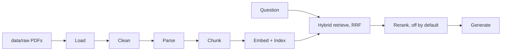

# Design notes

Decisions, architecture, measured results and known limits. Keep this file current when the
design changes. (Formerly `CLAUDE.md`; the overview is in the [README](../README.md).)

## Evaluation framework update — 28 October 2026

The sections below preserve the original application design and historical measurements.
The newer evaluation framework adds grounding/reference judges, human-review reports,
manifested per-question regression, controlled security checks and performance benchmarks.
Current file responsibilities and limits are in the [evaluation architecture](evaluation/ARCHITECTURE.md),
commands in the [runbook](evaluation/RUNBOOK.md), and evidence status in the
[progress tracker](evaluation/RAG_EVALUATION_PROGRESS.md).

Latest user-reported local CI-style verification: 426 passed, ten model-download tests skipped,
97% statement coverage and no warnings. GitHub CI has not yet been observed running.
Historical ruff/mypy successes below do not establish those checks for the new evaluation code.

## 1. Project purpose
Local RAG system answering questions about the GDPR (Regulation (EU) 2016/679) and the EU AI Act.
Every answer cites regulation, article/paragraph or recital, and PDF page, or refuses with
"Not covered by the provided documents". Output is not legal advice.

## 2. Quick start
```bash
uv sync --all-extras          # install (core + index + llm + api + dev)
cp .env.example .env          # defaults: local Ollama LLM
# the two PDFs must be supplied in data/raw/ (not included in this public export; filenames are discovered)
uv run rag-eu-law ingest      # parse, chunk, embed, index (about 17 s on CPU)
uv run rag-eu-law ask "What does GDPR Article 17 say?"
uv run pytest                 # tests + coverage
uv run rag-eu-law eval        # 26 questions, writes eval/report.md + eval/results.json (about 2.5 min with local Ollama)
uv run rag-eu-law eval --retrieval-only   # no LLM, seconds
uv run uvicorn rag_eu_law.app.api:app     # HTTP API: POST /ask, GET /health (docs at /docs)
uv run streamlit run src/rag_eu_law/app/ui.py   # web UI: ask, sources, 👍/👎 + note, History tab
```
Ollama must be running with the model in `RAG_OLLAMA_MODEL` pulled (`ollama pull qwen2.5:7b`).
To use OpenAI instead, set in `.env`: `RAG_LLM_PROVIDER=openai` and `RAG_OPENAI_API_KEY=...` (model defaults to `gpt-6-luna`).

### Shared history with Supabase (optional)
Default is a local SQLite file and no login. For a team: (1) create a Supabase project; (2) run
[supabase/migrations/0001_runs.sql](../supabase/migrations/0001_runs.sql) in its SQL editor; (3) create
each tester under Authentication > Users (sign-up is not exposed in the app); (4) in `.env` set
`RAG_RUN_STORE=supabase`, `RAG_SUPABASE_URL=https://<project>.supabase.co` and
`RAG_SUPABASE_ANON_KEY=<anon / publishable key>`. **Never put the `service_role` key in `.env`.**
(5) `uv sync --all-extras`, then start the UI; it shows a sign-in form first.

## 3. Architecture and flow

| Stage | Owning class | Status |
|---|---|---|
| Load | `PyMuPdfLoader` ([loader.py](../src/rag_eu_law/ingestion/loader.py)) | done |
| Identify regulation | `SignatureRegulationDetector` ([identify.py](../src/rag_eu_law/ingestion/identify.py)) | done |
| Clean | `LegalTextCleaner` ([cleaner.py](../src/rag_eu_law/ingestion/cleaner.py)) | done |
| Parse | `LegalStructureParser` ([parser.py](../src/rag_eu_law/ingestion/parser.py)) | done |
| Chunk | `LegalStructureChunker` ([chunker.py](../src/rag_eu_law/ingestion/chunker.py)) | done |
| Orchestrate | `IngestionPipeline` ([pipeline.py](../src/rag_eu_law/ingestion/pipeline.py)); writes `data/processed/chunks.jsonl` | done |
| Embed | `SentenceTransformerEmbedder` (default), `HashingEmbedder` (tests) ([embedder.py](../src/rag_eu_law/indexing/embedder.py)) | done |
| Vector store | `ChromaVectorStore` (default), `InMemoryVectorStore` ([vector_store.py](../src/rag_eu_law/indexing/vector_store.py)) | done |
| Keyword index | `Bm25KeywordIndex` ([keyword_index.py](../src/rag_eu_law/indexing/keyword_index.py)) | done |
| Index orchestration | `IndexingPipeline` ([pipeline.py](../src/rag_eu_law/indexing/pipeline.py)) | done |
| Embed (lite) | `FastEmbedEmbedder` (ONNX, no PyTorch; same vectors as the default: cosine 1.0, 25/26 identical top-5 lists on the eval) ([embedder.py](../src/rag_eu_law/indexing/embedder.py)) | done |
| Deploy | [Dockerfile](../Dockerfile), [docker/entrypoint.sh](../docker/entrypoint.sh), guide in [DEPLOY.md](../DEPLOY.md) | built and run locally, not deployed to a host (see DEPLOY.md) |
| Cloud start-up | `ensure_index` ([bootstrap.py](../src/rag_eu_law/app/bootstrap.py)); entrypoint [cloud/streamlit_app.py](../cloud/streamlit_app.py) with [cloud/requirements.txt](../cloud/requirements.txt) for Streamlit Community Cloud | built; verified in a clean venv locally, not on the platform |
| Wiring | `Container` ([container.py](../src/rag_eu_law/app/container.py)) | done |
| Retrieve | `HybridRetriever` ([hybrid.py](../src/rag_eu_law/retrieval/hybrid.py)) | done |
| Reference parsing | `parse_references` ([references.py](../src/rag_eu_law/retrieval/references.py)) | done |
| Fusion | `reciprocal_rank_fusion` ([fusion.py](../src/rag_eu_law/retrieval/fusion.py)) | done |
| Rerank | `NoOpReranker` (default), `CrossEncoderReranker` ([reranker.py](../src/rag_eu_law/retrieval/reranker.py)) | done |
| Prompts | `SYSTEM_PROMPT`, `build_user_prompt` ([prompts.py](../src/rag_eu_law/generation/prompts.py)) | done |
| LLM | `OllamaClient` (default), `OpenAIClient`, `AnthropicClient` ([llm_clients.py](../src/rag_eu_law/generation/llm_clients.py)) | done |
| Citation check | `verify_citations` ([citations.py](../src/rag_eu_law/generation/citations.py)) | done |
| Generate | `GroundedAnswerGenerator` ([generator.py](../src/rag_eu_law/generation/generator.py)) | done |
| Evaluate | `EvalRunner`, `summarize`, `write_report` ([evaluation/](../src/rag_eu_law/evaluation)); questions in [eval/questions.yaml](../eval/questions.yaml) | done |
| UI | `render` ([ui.py](../src/rag_eu_law/app/ui.py)): Ask and History tabs, ratings | done |
| Auth | `SupabaseAuthenticator` ([auth.py](../src/rag_eu_law/app/auth.py)): email/password; each user gets a run store using their own token | done, one real sign-in verified |
| History | `HistoryService` ([history.py](../src/rag_eu_law/app/history.py)), `RunStore` protocol with `SqliteRunStore` (default), `SupabaseRunStore` ([supabase_store.py](../src/rag_eu_law/storage/supabase_store.py)) and `InMemoryRunStore` ([storage/](../src/rag_eu_law/storage)); file `data/history.sqlite` | done |
| API | `create_api` ([api.py](../src/rag_eu_law/app/api.py)): `POST /ask`, `GET /health` | done |
| Ask (retrieve + generate) | `AskService` ([service.py](../src/rag_eu_law/app/service.py)) | done |

Interfaces: [protocols.py](../src/rag_eu_law/domain/protocols.py). Models:
[models.py](../src/rag_eu_law/domain/models.py). Wiring: [container.py](../src/rag_eu_law/app/container.py).

## 4. Decisions log
| Date | Decision | Reason | Rejected |
|---|---|---|---|
| 2026-10-19 | uv, Python 3.11, `src/` layout | fast, reproducible | Poetry |
| 2026-10-19 | PyMuPDF loader (AGPL, approved) | speed, per-page text | pdfplumber, pypdf |
| 2026-10-19 | Regex state-machine structure parser | documents are regular, deterministic | LLM parsing |
| 2026-10-19 | Chunk by paragraph (short articles whole); recitals/annex separate | legal citation granularity | fixed token windows |
| 2026-10-19 | Chroma local store | zero setup | Qdrant local |
| 2026-10-19 | BM25 (`rank_bm25`) + dense, RRF k=60 | article-number queries need keywords | weighted score sum |
| 2026-10-19 | `BAAI/bge-small-en-v1.5` embeddings, swappable | local, no key | OpenAI embeddings |
| 2026-10-19 | Ollama default LLM, Anthropic second client | user choice: local-first | hard-wiring a provider |
| 2026-10-19 | Accept EP-position AI Act text, label it "EP position 13 Mar 2024" | user approved; not the OJ text | wait for OJ PDF |
| 2026-10-19 | `p.` in citations = PDF page index | sources lack official pagination | printed page numbers |
| 2026-10-19 | Citations validated against retrieved chunk text | prevents invented points/articles | trusting LLM output |
| 2026-10-19 | Footnotes and superscripts dropped in the loader by font size (<=0.8x body) and position | footnote numbers are small in both PDFs; stops `Council11+` and OJ lines polluting chunks | regex on text (cannot tell footnote from body) |
| 2026-10-19 | Chapter/article/section/annex headings accepted only in numeric sequence | cross-references like `Article 290 TFEU should...` start lines in the GDPR | plain regex (121 false matches vs 99 real articles) |
| 2026-10-19 | Articles over 2500 chars split by `1.` paragraphs, else `(1)` definitions; parts packed to 2000 chars | matches citation granularity (Art. 4(1)); fits the embedder's 512-token window | one chunk per article always |
| 2026-10-19 | Line-end hyphens joined only if the fused word occurs elsewhere in the document; compounds (`high-risk`) keep the hyphen | avoids `highrisk` | always join, never join |
| 2026-10-19 | Regulation identified from first-page text, not filename | brief forbids hardcoded filenames | filename matching |
| 2026-10-19 | Embed `Article N (title)` heading + text; BM25 indexes the same text | "Article 22" / "Recital 47" queries match by number in both indexes | text only |
| 2026-10-19 | Chroma stores the whole chunk as JSON metadata plus flat filter fields | no second lookup; Chroma rejects None values | separate sidecar store |
| 2026-10-19 | BM25 index persisted as chunk JSONL, rebuilt in memory on load | corpus is ~1.2k chunks; rebuild takes milliseconds | pickling the BM25 object |
| 2026-10-19 | `Embedder.embed_query` added; bge query prefix applied there | bge-small is asymmetric | one `embed` for both |
| 2026-10-19 | Heavy libs imported lazily inside classes | optional `index` extra; fast CLI start | top-level imports |
| 2026-10-19 | Named articles/recitals/annexes in the question each add a filtered dense ranking with weight 2.0 to the RRF | neither BM25 nor dense finds "Article 17" (measured in step 3) | boosting scores after fusion; regex-only lookup that skips search |
| 2026-10-19 | A reference without a regulation is ranked once per regulation | "Article 22" exists in both laws; both should surface | guessing one regulation |
| 2026-10-19 | If the question names exactly one regulation, retrieval is filtered to it; a caller-supplied regulation filter wins | "Under the GDPR..." should not return AI Act text | never infer filters |
| 2026-10-19 | Cross-encoder reranker (`BAAI/bge-reranker-base`) implemented but off by default | brief: optional, off by default | making it mandatory |
| 2026-10-19 | Each source in the prompt carries a ready-made `cite as: [GDPR Art. 17(1), p. 61]` line | small local models copy tags far more reliably than they assemble them | asking the model to format citations itself |
| 2026-10-19 | Citation tags are verified against retrieved chunks: valid ones canonicalised (wrong page or unknown point repaired), unmatched ones removed | no invented articles in output | trusting model output |
| 2026-10-19 | Answer is refused when nothing was retrieved, the model refuses, or no citation survives verification | "cite every claim, or say Not covered" | returning uncited text |
| 2026-10-19 | Default Ollama model `qwen2.5:7b` (installed locally); `qwen3.6` also present but 24 GB | fast, no pull needed; `RAG_OLLAMA_MODEL` swaps it | llama3.1:8b (not installed) |
| 2026-10-19 | `latency_ms` is measured in `AskService` over retrieve + generate | what the user waits for | generation time only |
| 2026-10-19 | Eval: hit@5 counts a hit on ANY expected source; citation accuracy = answerable questions with at least one citation matching an expected source; refusal accuracy = out-of-scope questions with no citation | simple, auditable definitions | requiring all sources (too strict for cross-law questions) |
| 2026-10-19 | Eval runs retrieval once and generates from that context | one retrieval per question, results comparable between `--retrieval-only` and full runs | calling `AskService` (second retrieval) |
| 2026-10-19 | API: sync FastAPI endpoint, container built lazily on first request; errors map to 503 (empty index), 502 (LLM failure), 500 (other), 422 (bad input) | import stays cheap; clients can tell "not ingested" from "model down" | async endpoint (blocking model calls anyway) |
| 2026-10-19 | Keep the named-regulation filter on the whole search (variants that scoped it to references only were tried and scored worse) | measured on the eval set, see section 7 | scoping to reference rankings; extra named-law rankings |
| 2026-10-19 | OpenAI client for `gpt-6-luna` (cheapest OpenAI model, about $0.0005 per question by estimate); Chat Completions with `reasoning_effort=low`, `max_completion_tokens=2500`, no temperature | reasoning model: thinking tokens count against the limit and a custom temperature is not accepted (parameter names taken from OpenAI docs, to be confirmed by the first real call) | Responses API; default effort `medium` (more cost and latency) |
| 2026-10-19 | Run history behind a `RunStore` protocol; SQLite file first. Each run stores question, answer, citations, retrieved chunk ids, latency, `provider:model`, an index fingerprint (hash of `chunks.jsonl`), user, rating, note | review and re-test later; results stay comparable across models and data versions | writing history only to logs; going straight to Supabase |
| 2026-10-19 | Streamlit UI calls the project code directly (one process); the pipeline is built once with `st.cache_resource`; the last answer is kept in `st.session_state` so rating buttons survive reruns | simplest for a small team; Streamlit reruns the script on every click | UI as a client of the FastAPI service |
| 2026-10-19 | Supabase: accounts created by an admin (no sign-up in the app); the app holds only the anon key; row-level security: team reads all runs, inserts only as self (`user_id = auth.uid()`), may update only `rating` and `note` (column grant) | small closed team; the browser/server never holds an all-powerful key; saved questions and answers cannot be edited | public sign-up; service_role key in the app |
| 2026-10-19 | One Supabase client per signed-in user (supabase-py swaps the user's token into PostgREST requests on sign-in and refresh; checked in its source) | each request runs as that user, so RLS applies | one shared client with the service key |
| 2026-10-19 | Embeddings for deployment: ONNX `bge-small` via `fastembed` (`RAG_EMBEDDER=fastembed`, extra `index-lite`), not OpenAI embeddings | same model so retrieval is unchanged, no PyTorch (smaller image and RAM), no per-question cost, questions are not sent out for embedding | OpenAI embeddings (would change retrieval; needs re-eval) |
| 2026-10-19 | Deployment Setup A: one Docker container (Streamlit + ONNX embeddings + index baked at build time), OpenAI Luna for answers, Supabase for login and history | small team experiment on a cloud host with 1-2 GB RAM; secrets only as runtime environment variables | Streamlit Community Cloud (index and PDFs not in the repo, memory limits); Setup B (internal host with Ollama) kept for UAT |
| 2026-10-19 | Docker: `UV_NO_CACHE=1` (image 2.9 GB to 1.9 GB); ingestion in the image runs with `RAG_LLM_PROVIDER=ollama` because it never calls the LLM and no key exists at build time; pass a minimal `docker.env`, not the full `.env` | measured while building; the full `.env` would override `RAG_EMBEDDER` | baking keys into the image |
| 2026-10-19 | Free hosting on Streamlit Community Cloud: entrypoint in `cloud/` with its own minimal `requirements.txt`; in-memory vector store; index built at first start from the committed PDFs; embedding batch size 2; `ui.main` takes a container factory so a start-up spinner can show after `set_page_config` | the platform has no build step and picks `uv.lock` first (per its docs) which would install PyTorch; memory limits are small (batch 64 peaked at 2.5 GB, batch 2 at 593 MB for build+Streamlit, 487 MB process peak with questions) | Chroma on the platform (sqlite version and size risks); root-level dependency files |
| 2026-10-19 | Public sharing via a clean export, not by making this repo public: `scripts/export_public.sh <dir>` copies the project without git history, secrets, PDFs, generated indexes or `docs/INTERVIEW_SUMMARY.md`; `data/raw/README.md` says where to get the PDFs | the private repo's history and committed PDFs (third-party GDPR web print) should not be published; the private deployment keeps working | making the repo public as is; removing the PDFs from the private repo (breaks the Streamlit Cloud index build) |
| 2026-10-19 | Optional-dependency extras (`index`, `llm`, `api`) | light installs for early steps | one big dependency list |

## 5. Commands reference
| Command | What it does |
|---|---|
| `uv sync` | install core + dev deps (`--all-extras` adds index/llm/api) |
| `uv run ruff check .` / `uv run ruff format .` | lint / format |
| `uv run mypy` | strict typecheck of `src` and `tests` (config in `pyproject.toml`) |
| `uv sync --extra index` | install Chroma, BM25, sentence-transformers |
| `RAG_RUN_SLOW=1 uv run pytest tests/contract` | also runs the contract tests against the real bge model (downloads ~130 MB on first run) |
| `uv run rag-eu-law ingest [--raw-dir DIR]` | ingest PDFs, write `data/processed/chunks.jsonl`, build Chroma + BM25 indexes |
| `uv run rag-eu-law ask "<q>" [--regulation gdpr\|ai-act] [--article N] [--json] [--show-chunks]` | cited answer, or "Not covered by the provided documents" |
| `uv run rag-eu-law eval [--questions P] [--output-dir D] [--retrieval-only]` | hit rate@5, citation accuracy, refusal accuracy; report in [eval/report.md](../eval/report.md) |
| `uv run uvicorn rag_eu_law.app.api:app [--port N]` | serve `POST /ask` (`{"question", "regulation"?, "article"?, "top_k"?}` -> `answer, citations[], retrieved_chunks[], latency_ms, disclaimer`) |
| `uv run streamlit run src/rag_eu_law/app/ui.py` | web UI on http://localhost:8501 (uses the provider in `.env`; every question is saved to `data/history.sqlite`) |
| `uv run pytest` | unit/contract/integration tests with coverage (real-PDF test skips if `data/raw` lacks PDFs) |

## 6. Conventions
- New loader/cleaner/parser/chunker/embedder/store/LLM = new class implementing the matching
  protocol in `domain/protocols.py`, in its stage package. Never edit existing classes to add one.
- Register concrete classes only in [container.py](../src/rag_eu_law/app/container.py): add a factory to `EMBEDDER_FACTORIES` or `VECTOR_STORE_FACTORIES` and select it with `RAG_EMBEDDER` / `RAG_VECTOR_STORE`.
- Constants live in [constants.py](../src/rag_eu_law/domain/constants.py); config in
  [config.py](../src/rag_eu_law/app/config.py) (env prefix `RAG_`, see `.env.example`).
- Each protocol gets a shared contract test in `tests/contract/`.
- No `print` outside `app/cli.py`; raise exceptions from `domain/exceptions.py`.

## 7. Known issues and limits
**Eval results** (2026-10-19, `qwen2.5:7b`, top_k=5, 20 answerable + 6 out-of-scope, full report in [eval/report.md](../eval/report.md)):
retrieval hit rate@5 **100%** (mean recall 84%); citation accuracy **90%** (18/20); refusal accuracy
**100%** (6/6); false refusal rate **5%** (1/20). Mean latency 5.0 s. Caveats: small set written by
the implementer and checked against the ingested text, not independent; one run, no variance estimate.
- **Local vs OpenAI** (same 26 questions, same retrieval; reports in [eval/local-qwen2.5-7b/](../eval/local-qwen2.5-7b) and [eval/luna/](../eval/luna)):

  | | `qwen2.5:7b` (local) | `gpt-6-luna` (`reasoning_effort=low`) |
  |---|---|---|
  | retrieval hit rate@5 | 100% | 100% |
  | citation accuracy | 90% | 85% |
  | refusal accuracy | 100% | 100% |
  | false refusal rate | 5% | 5% |
  | median / mean / max latency | 5.4 s / 5.0 s / 18.9 s | 3.9 s / 5.4 s / 29.7 s |
  | mean answer length | 946 chars | 594 chars |

  The only per-question difference is x05 (Luna cites Recital 38 only). One run each on a small set,
  so the 5-point gap is one question: no evidence either model is better. Luna answers are shorter and
  hedge more honestly (x01 says the documents do not explain it), but still cite the recital.
  Token usage was not logged, so cost per question is still the estimate (about $0.0005), not measured.
- Eval failures (local run): x01 (cites Recital 38, not an expected source, and over-reads it) and x02 (refused
  although retrieved). Cause of x02: the question names "GDPR", so retrieval filters to GDPR and
  never sees AI Act Art. 10.
- **Tried and rejected (2026-10-19)**, each with a full eval run on the 26 questions:
  (a) named regulation scopes only the explicit-reference rankings: x02 fixed, but c03 and x06 broke
  (hit@5 95%, citation accuracy 85%); (b) as (a) plus extra rankings restricted to the named law:
  hit@5 100%, citation accuracy 80%, false refusals 10% (x02 still missed, d02 refused). The original
  behaviour was restored and re-run: identical to the first run (100% / 90% / 100% / 5%), so the
  difference is not noise. Open idea: attribute a regulation name to the nearest article reference
  instead of the whole question; needs a larger eval set before tuning further.

Found by inspecting `data/raw/` (459-page AI Act PDF, 117-page GDPR PDF; all text extractable):
- **AI Act file is `P9_TA(2024)0138`**, the European Parliament first-reading text of
  13 March 2024, not the final Regulation (EU) 2024/1689. Wording/recital numbers may differ.
- AI Act: number tokens (`1.`, `(a)`) sit on their own line; footnotes interleaved; 146 `▌`
  markers and 19 drafting notes to strip; recitals pp. 4-159, Art. 1 on p. 160, Annex I on p. 418;
  113 articles, 13 annexes.
- GDPR (`full.pdf`, web print): ligatures (`fi fl ff ffi`), 212 end-of-line hyphens, bare page-number
  footer, "View: Official source" line, article heading is one line (`Article 17 Right to erasure`).
- Page numbers cited are PDF page indices.
- Footnotes (mostly OJ references) are dropped, so they are not retrievable. Footnote numbers inside
  text are dropped too.
- Hyphen repair is heuristic (vocabulary of the same document); a few compounds seen only once
  (for example `start-ups`) may be joined. A hyphen at the very end of a page is not repaired.
- Chunk `paragraph` for GDPR Art. 4 and AI Act Art. 3 is the definition number (`Art. 4(1)`).
  Annex and recital chunks have no paragraph. Citation points like `(a)` are not stored in
  metadata; step 5 derives them from the chunk text.
- AI Act chapter titles are upper-case as printed; EP text differs from the OJ text (for example
  Chapter IX title).
- Page number `p.` is the PDF page index (GDPR printed page numbers match; AI Act has none).
- Result on the real PDFs: 99 + 113 articles, 173 + 180 recitals, 13 annexes -> 1154 chunks
  (AI Act 700, GDPR 454), longest 2000 chars, re-ingestion byte-identical.
- Indexing real data: 1154 chunks in ~17 s on CPU (first run also downloads `bge-small-en-v1.5`);
  re-indexing leaves counts unchanged (upsert by `chunk_id`).
- Dense or BM25 alone cannot find "Article 17"; step 4 fixes this with reference parsing (checked
  on the real index: "GDPR Article 17" returns Art. 17 paragraphs first).
- Reference parsing limits: a regulation name applies to the whole question, not to the nearest
  article ("AI Act Article 10 and GDPR Article 9" searches both laws for both articles);
  sub-paragraph references like `6(1)(a)` are reduced to the article; ranges ("13 to 15") are
  not expanded.
- `CrossEncoderReranker` is covered by a fake-model unit test only; the real model (about 1 GB)
  was not downloaded or evaluated.
- Dense score of an off-topic query is about 0.43 vs 0.75-0.86 for relevant ones: usable as a
  refusal signal, to be tuned in eval.
- Tried end to end with local `qwen2.5:7b` on 5 questions: Art. 17, DPIA (Art. 35) and Art. 5 answers
  cite correctly (5-22 s each); an off-topic question is refused. A cross-regulation answer cited
  the right recital but its reasoning overreached the source (mixed up Directive 2016/680 with the
  GDPR). Citation checking guarantees the cited location exists, not that the claim is faithful.
  The eval above measures citation accuracy; a stronger model (`RAG_LLM_PROVIDER=anthropic`) helps.
- The model sometimes pastes long source text verbatim; answers can be long. Prompt asks for
  concision; not enforced.
- Retrieval always returns top-k, so off-topic questions rely on the model (or an empty
  citation set) to refuse; there is no relevance threshold yet. Tune in eval if needed.
- CLI: `ingest` rebuilds everything from the PDFs each run (idempotent). `ask` exit code is 1 with a one-line message on project errors (missing PDFs, empty index, LLM down).
- UI limits: without Supabase there is no login (the name box is self-declared); answers are not streamed (a spinner shows for about 5-12 s, the first question after start-up is slower because the embedding model loads); history is one local SQLite file, not shared between machines. Planned next: an export of rated runs into draft eval questions.
- **Supabase, verified 2026-10-19 against a real project:** the migration applied; anonymous select and insert are denied (permission denied, code 42501); a wrong password is rejected; a user signed in through the UI, asked a question, rated it, and saw the run in the `runs` table and the History tab (checked by the user, not automated). **Not yet verified:** a second user reading the first user's runs, and the column grant that blocks edits to saved questions and answers (both covered only by the fake client and by reading the SQL). Sessions live in Streamlit session state, so a browser refresh signs the user out. Question and answer text is stored in the cloud database.
- `AnthropicClient` and `OpenAIClient` are covered with fake clients only (no API keys were available). `OpenAIClient` has not made a real call yet; run `uv run rag-eu-law eval` with `RAG_LLM_PROVIDER=openai` and compare with the local-model numbers above before relying on it.

## 8. Step log
| # | Step | Status |
|---|---|---|
| 0 | Inspect PDFs, propose plan | done, approved 2026-10-19 |
| 1 | Scaffold, domain models, protocols, exceptions, settings, CLAUDE.md | done (ruff, mypy --strict, 15 tests pass, 100% coverage) |
| 2 | Ingestion (load, clean, detect, parse, chunk, pipeline, jsonl) | done (ruff, mypy --strict, 72 tests, 99% coverage) |
| 3 | Indexing (embedder, Chroma, BM25, container, pipeline) | done (ruff, mypy --strict, 112 tests + 36 slow contract tests against the real model) |
| 4 | Retrieval (references, RRF, hybrid retriever, rerankers) | done (ruff, mypy --strict, 150 tests, 97% coverage) |
| 5 | Generation (prompts, Ollama + Anthropic clients, citation verification, AskService) | done (ruff, mypy --strict, 181 tests, 97% coverage); real Ollama run checked by hand |
| 6 | CLI: `ingest`, `ask` ([cli.py](../src/rag_eu_law/app/cli.py)), JSON logging to stderr, 3-page sample integration test | done (ruff, mypy --strict, 192 tests, 97% coverage); `eval` command arrives with step 7 |
| 7 | Eval: 26 questions, `eval` command, report | done (ruff, mypy --strict, 205 tests, 97% coverage); numbers above |
| 8 | API: `POST /ask`, `GET /health`, tests with fake container, run against the real index | done (ruff, mypy --strict, 218 tests, 98% coverage) |

Steps 9-10 (after the original brief): OpenAI client (`gpt-6-luna`), run history (`RunStore`, SQLite) and the Streamlit UI are done (ruff, mypy --strict, 249 tests); verified by hand in the browser with Luna: answer, citations, sources, rating saved. Supabase auth + Postgres store added (one real sign-in, ask and rate verified, see section 7). Streamlit Community Cloud entrypoint added (verified locally in a clean venv only). Next: deploy it and test with a second user; export of rated runs to eval questions.

All eight steps of the original brief are complete. Definition of done: `ingest` runs on both PDFs without errors and is idempotent (byte-identical `chunks.jsonl`, unchanged index counts); `ask` returns cited answers and refuses out-of-scope questions; ruff, mypy --strict and tests pass; eval numbers are in section 7.

