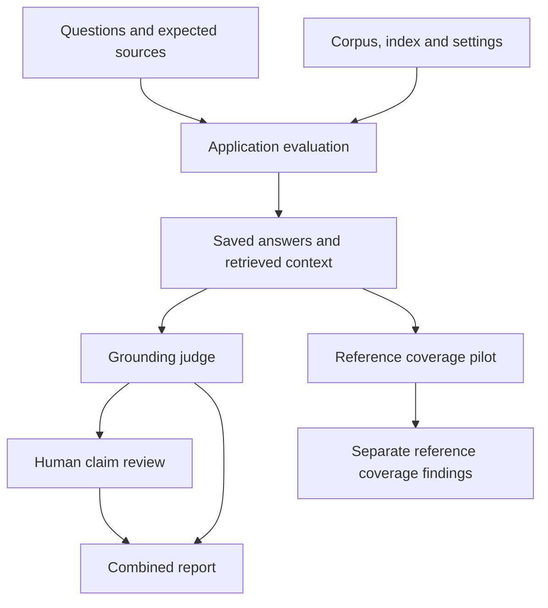

# Evaluation architecture and file map

The evaluation framework observes the existing application. It does not rewrite source labels
or modify retrieval/generation to make a test pass. Recorded failures remain findings.

## What each layer consumes and produces

| Layer | Input | How it checks | Output / owning files |
|---|---|---|---|
| Source/chunks | PDFs and chunks.jsonl | Schema, IDs, text, readable pages and page bounds; manual fidelity sampling | `scripts/validate_corpus.py`; issue JSON |
| Retrieval | Questions, expected sources, configured index | Run actual retriever; match regulation/article/recital/annex | `runner.py`, `metrics.py`; results/context, report |
| Provenance | Dataset, files, settings, environment and Chroma collection | Hash before/after; logical records/configuration plus non-SQLite search files | `provenance.py`, `index_fingerprint.py`; provenance.json |
| Grounding | Saved answer and its retrieved chunks | LLM extracts and classifies claims against supplied context | `judge.py`, `judge_models.py`; claim verdicts/evidence/reasons |
| Reference pilot | Answer, approved facts and reference chunks | LLM compares required facts with exact answer quotes | `reference_loader.py`, `reference_judge.py`, `reference_metrics.py` |
| Human review | Flagged or sampled claims with evidence | Review each original claim position; retain decisions separately | `judge_report.py`; pending/reviewed/unresolved report sections |
| Regression | Compatible baseline and candidate | Reject invalid identity; compare aggregate and each answerable question | `regression.py`, `scripts/check_manifested_regression.py` |
| Robustness | Full CLI questions or controlled generation contexts | Save raw/final outputs and observations; review semantics | `scripts/run_robustness.py`, `scripts/run_generation_security.py` |
| Performance | Repeated measured attempts | Separate warm-up, retrieval/generation timing, errors and stability | Benchmark scripts; `performance_metrics.py` |

Module names without a path are under `src/rag_eu_law/evaluation/`.

## Evidence relationships

Grounding uses retrieved context; reference coverage uses approved facts and reference evidence.
A claim can be supported but incomplete against a more detailed required fact. Neither metric
alone establishes overall legal correctness. Reference metrics are not silently blended into
claim-support rates.

## Provenance policy

Version-2 retrieval identity includes dataset bytes, source PDFs, chunks, keyword index, logical
vector records/configuration/metadata, non-SQLite index files, retrieval settings, application
Python files and selected environment/package versions. Physical Chroma SQLite changes are
retained as diagnostics because bookkeeping can change without logical record changes.
Different strict identity fields make runs incompatible; the gate does not score them.

Captures are not atomic snapshots of concurrent writers. Stop index writers. Model weight
artifacts are not pinned, ingestion lineage is not fully enforced, and script files outside the
application package are not part of its source-file identity. Equal fingerprints do not prove
identical query results, authenticity or answer correctness.

## Operational boundaries

The checkpoint judge runner preserves completed records and refuses changed input/configuration.
Combined reporting validates saved input hashes and maps reviews by question plus original
claim position. Human reviews do not overwrite model judgments or manufacture independence.
Software CI uses fakes for model calls and skips ten download-gated cases; it does not execute
paid evaluation runs, approve performance targets or establish live-model security.

See the [runbook](RUNBOOK.md) for executable commands and the
[tracker](RAG_EVALUATION_PROGRESS.md) for completed scope and remaining work.
